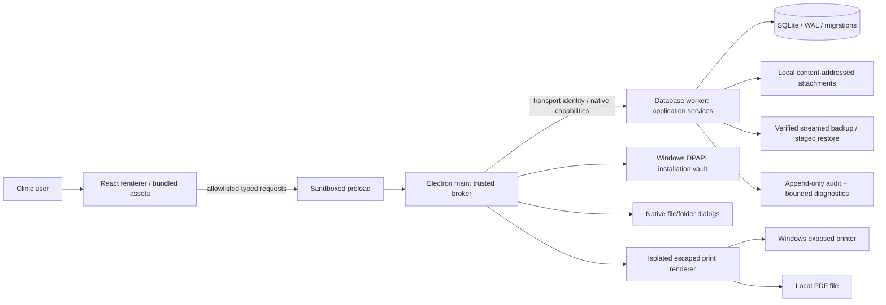

# Architecture — Dentiva Pro

Status: planning baseline approved by engineering evaluation on 2026-09-30; implementation/verification status is tracked separately. Version target 1.0.0, not released.

## Topology and trust boundaries



No production localhost server, paid API, remote auth, telemetry, cloud account, updater or remote asset dependency. Development uses an explicitly excluded HTTP adapter and Vite same-origin proxy to exercise the same service. Browser preview is development, not the Windows product.

## Runtime

- Main acquires a single-instance lock, registers an application-local protocol, initializes per-user directories and DPAPI vault, then starts one worker. Main never evaluates clinical HTML from users.
- Renderer has Node integration off, context isolation on, sandbox on, navigation/window-open denied, restrictive CSP; dev tools disabled for packaged default. Disable webview and remote module. All arbitrary external network requests denied in production.
- Preload exports only typed `request(command, payload)` and narrow broker-owned dialog/print operations. Commands are statically allowlisted. Validate sender frame URL and webContents identity before forwarding. No `fs`, `shell`, `execute`, raw SQL or arbitrary channel export.
- Worker opens SQLite with `foreign_keys=ON`, `journal_mode=WAL`, `synchronous=FULL`, `busy_timeout`, and migration version/integrity checks. Business mutations serialize; long backup/restore blocks writes deliberately, with progress. Keep queries indexed and paginated. Heavy work never runs in renderer.
- Runtime error responses use stable codes and friendly English messages. Diagnostics exclude request bodies, PHI and credentials. Worker failures render recovery UI rather than blank screens; do not automatically retry non-idempotent financial writes.

## Data flow

1. User submits typed form data; UI performs helpful validation but is untrusted.
2. Broker supplies unforgeable transport identity, not a user ID chosen by renderer.
3. Service checks activation/setup/session/idle expiry, loads active user's current permissions, validates payload and domain invariants.
4. Repository transaction writes normalized records and audit entry; rollback on any failure.
5. Response projects only permitted fields. Patient balances, invoice amounts, salary, clinical findings each require their domain permission; DTO redaction is not left to the UI.
6. UI updates result from actual persisted response; errors preserve entered form values and enable safe retry. Dangerous actions require reauthentication/typed confirmation.

## Authentication, activation and local security

- Password verifier: scrypt with random salt and a versioned format/work factor; default target N=32768, r=8, p=1, 32-byte output, adequate memory budget, asynchronously processed. Validate password length (12–128 characters at baseline), do not silently truncate; never accept malformed digest. Timing-safe byte comparison.
- Fixed-code activation uses a separately salted memory-hard verifier, not a source plaintext constant or simple equality. Receipt authenticated with a random installation key and protected by DPAPI in packaged Windows. It persists across restart but is not portable with clinical backups. No original code in tests, comments, snapshots, logs or docs. An offline known-code scheme is bypassable by sufficiently skilled local attackers.
- Session belongs to trusted transport identity; memory-only, not localStorage. Server idle timeout is authoritative. Lock invalidates session access while renderer retains unsaved values behind an inaccessible lock overlay. Successful login/failed login/logout/lock/password/role changes audited without secrets.
- Failed login and activation have bounded attempts/backoff, generic username/password error and audited security event. Administrator can locally reset users with reauthentication; no insecure email-based recovery or hidden master account.
- Permission keys checked in every business command. Financial searches, totals, exports, notifications and profile balances independently checked. Read SQL is internal only. UI permission filtering improves UX but provides no security guarantee.
- SQLite and attachments are not encrypted by this baseline. Windows account ACLs, per-user LocalAppData and disk encryption are operational controls. Local OS administrators/source editors can read or tamper with files; application RBAC does not defend against an OS administrator. No dishonest claim of whole-database encryption.

## Filesystem layout (Windows)

```text
%LOCALAPPDATA%/Dentiva Pro/
  data/clinic.sqlite          main database (+ WAL/SHM)
  objects/<generated-id>      attachment/logo/photo bytes, never original filename as path
  security/                   DPAPI-protected key + authenticated activation receipt
  logs/                       sanitized rotating diagnostics
  staging/                    bounded pending backup/restore/import, cleaned on startup
```

Database backup contains clinical objects and normalized configuration, hashes and user password verifiers, not plaintext passwords. It does not contain installation security keys, sessions, logs, test records or executable application files. Backups are sensitive and not assumed encrypted; warn operators to secure their storage. Native folder/file dialogs grant narrow server-owned capabilities. Renderer never sends arbitrary filesystem paths.

## Attachments

Accept only explicitly supported PDF/image/common document formats; validate byte signatures, MIME/size and ZIP-based document structure, not extension alone. Original filename is display-only, normalized and escaped. Generated ID prevents traversal/collision/overwrite. Quarantine before metadata commit; content hashes for backup. Never execute, embed scripts or open HTML/SVG as trusted content. Preview PDF/images in isolated local views; unsupported safe documents exported/opened only through explicit user action. Permission checks apply to list/read/export/delete, not just metadata.

## Printing and PDF

Dedicated `src/printing` reads authorized snapshots from service, escapes every user field, and renders immutable document templates. Load bundled Inter/Noto Sans Bengali; await `document.fonts.ready`/images before output. Printer profiles store document type, Windows device name, paper dimensions, margins, orientation, copies. Never blindly shrink A4. Prescription: wide two-column clinical/Rx on A4/A5, stacked narrow template, continued medicine rows, footer and physical blank signature space; optional digital signature only when explicitly configured. Invoice: reflow narrow items/totals, no doctor signature or prescription footer. Isolated print window shows actual HTML/PDF preview; native printer mechanism handles Windows-exposed devices, `printToPDF` local Save dialog. Actual Bengali shaping/PDF/page breaks tested with long data and Windows physical devices.

## Backup/restore

See `BACKUP_RESTORE.md`. SQLite online backup API, write coordination and immutable object snapshot; streamed archive, manifest/hashes, stage and rename. Validation precedes success. Restore integrity/schema/file validation in staging, mandatory verified pre-restore backup, then close DB and replace with rollback-safe directory swap. Invalidate sessions and reopen/check database; never merge unrelated ledgers. Automatic backups while app runs; due on startup; failure notified/retry recorded. No claim that backups happen while computer/app is off.

## Installer and updates

NSIS per-user x64 bundles full Electron runtime, production service, UI, migration SQL, fonts/icon/notices. No dev backend/tests/data or install-time network. Create Start/Desktop shortcuts and uninstall entry with matching icon. Default uninstall removes program files, preserves local clinical data and says so. Upgrade uses same app ID/data directory, backup before schema changes and rollback-aware migrations. No online auto-update. Code-sign certificate may be provided externally; don't invent publisher validation.

## CI, dependencies and release

Lockfile + `npm ci`; exact direct versions after compatibility validation. Linux lint/types/unit/real SQLite/integration/Playwright/offline/static build/audit. Windows native-addon/desktop smoke and gated NSIS build/artifacts; archive checksum and version/commit/build/schema info. `release-gates` rejects missing acceptance evidence. GitHub Release only after clean-machine and packaged-app/printer/uninstall tests; user merges PR. Audit actual transitive/runtime licenses and security advisories, not just package descriptions. See RELEASE_CHECKLIST and THIRD_PARTY_NOTICES.

## Recovery and performance

Atomic domain operations + WAL/FULL durability, integrity on suspicious shutdown, bounded paginated requests, deterministic money, UTC/Dhaka utilities, append-only audit. Stage outputs in same volume for rename; preserve originals on failure. Stress targets are objectives until measured. `docs/AGENT_STATE.md` records evidence and blockers; no release success inferred from build configuration.
