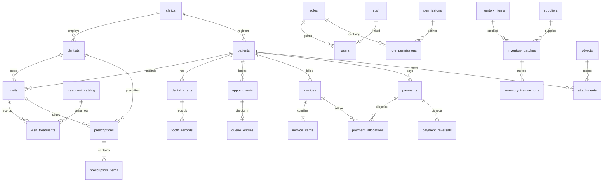

# Database / entity-relationship design

SQLite is the authoritative local store. This is the complete intended model, not evidence that every entity/service/screen is implemented. Migrations are introduced with the vertical slice using each entity. Actual schema version is read from `schema_migrations` and reported in About/build evidence.

## Global conventions

- Primary keys: generated opaque text IDs (UUID), never user filenames. Audit/movement sequence may use integer primary key for stable pagination. All IDs use parameter binding, never SQL interpolation from renderer.
- Instants: ISO 8601 UTC (millisecond precision); local date-only values `YYYY-MM-DD`, Dhaka calendar for booking/filtering. Created/updated actor foreign keys as applicable. Immutable transaction timestamp reflects actual commit, separate from permitted business effective date.
- Money: integer poisha (1 BDT = 100), `CHECK >=0` where relevant, bounded safe integer ≤9,000,000,000,000; ledger direction/reversal fields distinguish negatives, not negative user inputs. Inventory quantities in integer milli-units. Fees/quantities validated before multiplication.
- Statuses/roles/types have CHECK/lookup constraints. Boolean integer CHECK 0/1. Text lengths and date validity in service and critical DB checks. Optional fields NULL or empty consistently; no undefined serialization.
- Foreign keys ON; restrict clinical/financial/user deletion; selective cascade only for genuinely owned draft configuration/line rows. Archival is normal removal. No cascade patient→invoice/payment/visit deletion.
- `schema_migrations(version INTEGER PK, name TEXT UNIQUE, applied_at TEXT, checksum TEXT)`; migrations atomic and checksummed. No edits to applied SQL. Pre-migration verified backup for existing business data. Reject newer/unsupported schema safely.

## Entity catalog

Fields listed in addition to ID and standard creation/update timestamps/actors when meaningful. Required relationships below are enforced by FKs, not merely IDs in text.

### Installation / clinic / identity

| Table | Principal fields | Relationships / constraints |
|---|---|---|
| clinics | name, address, phone, alternate_phone, email, website, timezone=`Asia/Dhaka`, currency=`BDT`, footer, logo_object_id, setup_completed_at | Single active clinic per installation; actual logo metadata references local objects |
| clinic_hours | clinic_id, weekday, opens_at, closes_at, closed | Unique clinic+weekday; local times, closed-day invariant |
| dentists | clinic_id, name, title, registration, specialty, phone, email, photo_object_id, signature_object_id, signature_enabled, active | Independent profiles, no fake default doctor |
| dentist_designations | dentist_id, value, sort_order | Multiple ordered entries, FK owned cascade |
| dentist_qualifications | dentist_id, value, sort_order | Multiple ordered entries |
| dentist_certifications | dentist_id, value, sort_order | Multiple ordered entries |
| dentist_availability | dentist_id, weekday, start_time, end_time, slot_minutes, active | Ordered valid interval; unique dentist/day/start |
| staff | clinic_id, name, DOB, gender, blood_group, address, phone, identification, department, joined_on, salary_poisha, emergency_contact, notes, photo_object_id, status | Salary/ID sensitive projections; linked users remain after archive |
| users | clinic_id, username, normalized_username, password_hash, staff_id?, dentist_id?, role_id, active, last_login_at, password_changed_at | Unique normalized username; no plaintext, cannot orphan last admin |
| roles | name, description, system_key?, protected | Unique name; built-in defaults but custom roles allowed |
| permissions | key PK, group_name, description | Fixed registered permission allowlist |
| role_permissions | role_id, permission_key | Composite PK/FKs; no arbitrary unregistered keys |
| auth_throttles | subject_hash, failures, blocked_until, last_failure_at | No raw input/password; cleanup/retention; persist restart throttles |
| settings | clinic_id, key, value_json, updated_by | Unique clinic+key, typed validated per allowlisted setting; no activation secret |
| number_sequences | clinic_id, kind, next_value | Unique kind; transactional allocation for visible codes/numbers |

Activation/key/receipt lives in DPAPI-protected installation files, not transferable database backups. Sessions live in memory, not stored raw in DB.

### Patient / clinical longitudinal record

| Table | Principal fields | Relationships / constraints |
|---|---|---|
| patients | clinic_id, code, full_name, search_name, DOB?, stated_age?, gender, blood_group, address, phone, normalized_phone, email, complaint, notes, emergency_relationship, preferred_language, assigned_dentist_id?, referral_source, registered_at, status, archived_at | Unique clinic+code; valid age/DOB; dentist FK; no business record cap |
| patient_contacts | patient_id, kind, name?, relationship?, phone, primary_flag | Emergency/additional contacts, FK owned |
| patient_medical_history | patient_id, category, content, active, recorded_at, recorded_by | Medical/dental/prior problems/current medications separately typed |
| patient_allergies | patient_id, allergen, reaction, severity, active, recorded_by | Warning relevant to visit/Rx, no overwriting historical allergy |
| tags | clinic_id, name | Unique clinic+normalized name |
| patient_tags | patient_id, tag_id | Composite PK, explicit FK junction |
| visits | patient_id, dentist_id, number, occurred_at, reason, chief_complaint, history, examination, diagnosis_summary, advice, followup_on?, notes, status, finalized_at? | Independent append visit; unique visible number; FK restrict |
| visit_amendments | visit_id, reason, content_json, amended_at, amended_by | Append corrections with provenance; no silent finalized edits |
| diagnoses | visit_id, code?, description, tooth_number? | Multiple diagnosis records |
| clinical_findings | visit_id, vocabulary_id?, kind, text, tooth_number? | Structured C/C/O/E with custom text preserved |
| clinical_options | clinic_id, kind, code, label, active, sort_order | Configurable C/C/O/E/advice/conditions/appointment types; unique kind+code |
| dental_charts | patient_id, dentition, numbering_system=`FDI`, created_at | Adult/pediatric identified chart context, unique patient+dentition |
| tooth_conditions | clinic_id, code, label, color_token, active | Configurable condition reference, never executable CSS |
| tooth_records | chart_id, tooth_number, condition_id, state, visit_id?, notes, recorded_at, recorded_by, supersedes_id? | Append history. FDI number validated per dentition; previous states never deleted |
| treatment_catalog | clinic_id, code, name, category, description, default_fee_poisha, duration_minutes, notes, active | Unique code; fees configurable and financial projections gated |
| dentist_treatment_prices | dentist_id, treatment_catalog_id, fee_poisha | Composite unique pair |
| visit_treatments | visit_id, treatment_catalog_id?, description_snapshot, tooth_number?, quantity, unit_fee_poisha, status, performed_at | Snapshot retains history when catalog changes; permitted money redaction |
| prescriptions | patient_id, visit_id?, dentist_id, number, prescribed_at, complaint, examination, advice, notes, followup_on?, status, amended_from_id? | Mandatory dentist; patient consistency validated; append/amend original |
| prescription_items | prescription_id, sort_order, medicine, form, strength, dose, quantity?, morning, noon, night, frequency, meal_relation, duration, prn_instruction, instructions | Multiple medicine lines; unique prescription+order |
| referrals | patient_id, visit_id?, date, referred_by_dentist_id?, referred_to, doctor, institution, reason, clinical_summary, notes, status, followup_on?, outcome | Linked immutable history/amendment as appropriate |
| patient_notes | patient_id, visit_id?, content, created_by, amended_from_id? | Dated authored note; clinical permission |
| patient_events | patient_id, event_type, entity_type, entity_id, occurred_at, actor_id, safe_summary | Timeline index, IDs internally generated; projection per event domain; audit separate |

Timeline generation and record mutation share transaction. Event summaries never duplicate hidden invoice amounts/clinical notes into patient identity responses. Current dental chart is latest state per tooth/condition via ordered indexed events. Unlimited history is paged, not JSON overwritten on patient row.

### Scheduling / queue

| Table | Principal fields | Relationships / constraints |
|---|---|---|
| appointments | patient_id, dentist_id, starts_at, ends_at, type_id?, reason, status, notes, reminder_minutes, source, created_by, rescheduled_from_id? | Valid increasing interval; server overlap check in serialized write transaction, local availability and cancelled exclusion |
| appointment_events | appointment_id, from_status, to_status, reason, timestamp, actor_id | Append status/reschedule history |
| queue_entries | patient_id, appointment_id?, dentist_id, clinic_day, queue_number, priority, checked_in_at, called_at?, started_at?, completed_at?, status | Unique clinic_day+queue_number; one active appointment entry; one active patient/dentist slot, transitions enforced |

### Finance

| Table | Principal fields | Relationships / constraints |
|---|---|---|
| invoices | patient_id, visit_id?, dentist_id?, number, issued_at?, effective_date, status, subtotal_poisha, line_discount_poisha, invoice_discount_poisha, tax_poisha, total_poisha, notes, void_reason?, voided_by?, voided_at? | Unique number; immutable issued totals; bounded nonnegative and arithmetic checks |
| invoice_items | invoice_id, treatment_catalog_id?, sort_order, description_snapshot, quantity, unit_price_poisha, discount_poisha, line_total_poisha | Ordered immutable issued line snapshots; totals integer-calculated |
| payment_methods | clinic_id, name, category, active | Seed Cash/Bank/Card/mobile wallets/Other; fully configurable labels |
| payments | patient_id, number, amount_poisha, received_at, received_by, payment_method_id, reference, notes, status | Amount>0; append receipt, no ordinary destructive updates |
| payment_allocations | payment_id, invoice_id, amount_poisha | Same patient; total payment allocation equality, cannot overallocate invoice; FK restrict |
| payment_reversals | payment_id, amount_poisha, reason, reversed_by, reversed_at, reference | Linked reversal rather than erase original; bounded aggregate ≤ original |
| expense_categories | clinic_id, name, kind, active | Configurable income/expense; default relevant clinic categories |
| accounting_entries | clinic_id, direction, category_id, amount_poisha, effective_date, payment_method_id?, vendor?, supplier_id?, reference, notes, attachment_id?, inventory_transaction_id?, created_by | Positive amount with direction; linked purchases atomic; no duplicate collections as income when reports derive receipt ledger |
| accounting_reversals | entry_id, amount_poisha, reason, reversed_by, reversed_at | Controlled linked adjustments |

Derived outstanding = issued non-void invoice total − active net allocations. No mutable cached patient balance. Financial views reconciled in queries. Revenue is issued invoices net permitted reversals; collections is valid net payments; cash movement is collections+other income−expenses/refunds, with non-overlapping definitions. DB triggers/service protect issued items and immutable payments; reversals audited. No cascade of invoice/payment on patient deletion.

### Inventory / files / operations

| Table | Principal fields | Relationships / constraints |
|---|---|---|
| suppliers | clinic_id, name, contact, phone, address, email, notes, active | Referenced purchase history preserved |
| inventory_items | clinic_id, code, name, category, supplier_id?, purchase_source, unit, min_quantity_milli, usage_price_poisha?, storage_location, notes, active | Unique SKU; no silent stock overwrite |
| inventory_batches | item_id, lot_number, supplier_id?, purchase_source, unit_cost_poisha, expires_on?, received_on, location, notes | Stock per batch; immutable purchase metadata if used |
| inventory_transactions | batch_id, type, quantity_milli, occurred_at, actor_id, reference, reason, visit_id?, reversal_of_id? | Positive amount; type sets direction; serialized stock check and audit; no destructive mutation |
| objects | id, sha256, bytes, mime_type, extension, created_at | Generated IDs, blob local filesystem; paths constructed internally |
| attachments | patient_id?, visit_id?, accounting_entry_id?, object_id, original_name, description, uploaded_by, uploaded_at, deleted_at? | Owner/scoped access; content signature and size validated; FK restrict object still referenced |
| notifications | scope, event_type, entity_type, entity_id, severity, occurred_at, safe_message, required_permission | Real locally derived/recorded events; no sensitive public summary |
| notification_reads | notification_id, user_id, read_at | Composite PK; per-user state |
| audit_logs | integer sequence PK, occurred_at, user_id?, action, entity_type, entity_id?, success, metadata_json | Append only in normal API; metadata minimal/no credentials; indexes for authorized pagination |
| backups | created_at, completed_at?, kind, schema_version, app_version, manifest_sha256?, native_location_reference?, status, safe_error? | Success only verified final archive; sensitive paths scoped, backup audit record |
| printer_profiles | clinic_id, name, document_type, printer_name, paper_kind, width_um, height_um, orientation, margins_json, copies, is_default | Numeric valid paper sizes/margins; Rx/invoice independent |

## Relationship overview

## Index strategy

- Unique clinic code/username/catalog/SKU/document number and role-permission junctions.
- `patients(status,registered_at DESC,id)`, `(assigned_dentist_id,registered_at DESC,id)`, normalized phone and search name prefix; separate FTS5 identity search with Unicode tokenizer/prefix (if search benchmarks justify) and code index. Clinical search partitioned by domain permissions.
- `visits(patient_id,occurred_at DESC,id)`, `patient_events(patient_id,occurred_at DESC,id)` and each patient history FK/date.
- Appointments `(dentist_id,starts_at,ends_at,status)`, `(patient_id,starts_at)`; queue `(clinic_day,dentist_id,status,priority,checked_in_at)`; partial unique active appointment entries.
- Invoices `(patient_id,issued_at DESC,id)`, `(status,effective_date)`; allocations invoice and payment; receipts date/method; reversals original ID.
- Inventory transactions batch/date, batches item/expiry, audit timestamp/actor/action/entity, settings and object hashes. Every FK used for joins indexed.
- Query limits cap a single page, not dataset size. Stable keyset pagination for timeline/audit and offset pages with count for manageable lists; avoid loading entire histories.

## Migration and integrity operations

Fresh setup creates DB/migrations/reference vocabularies and roles but zero patient/clinic/user records until explicit setup. Run `foreign_key_check`, `quick_check` at appropriate recovery/open points. Migrations transactionally apply checksum/version changes; trusted SQL shipped locally, no executable backup migrations. Test fresh schema, upgrade with existing records, FK violations, unique collisions, failure rollback, forced interruption/reopen and large-index query plans. Restore accepts only supported schema, validates `integrity_check`, foreign keys and business constraints before any destructive step. See backup documentation for consistent online snapshot.
